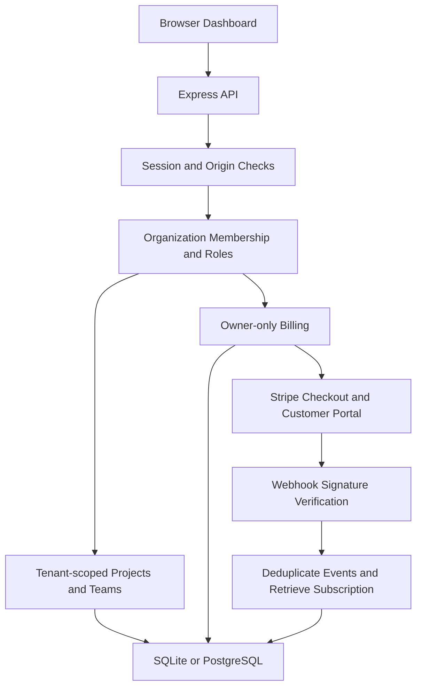

# TenantFlow

### Secure organizations. Clear access. Stripe subscriptions.

TenantFlow is a standalone multi-tenant SaaS project for **Nexlevr Level 03 — Task 02**. One account can belong to multiple organizations. Each organization has its own projects, memberships, invitations, audit log, Stripe customer, and subscription.

**Project status:** Local application running; automated integration tests and production build passed. Authentication, tenant-scoped project management, roles, quotas, and Stripe integration are implemented. This submission uses a local demo and screenshots; no public deployment is provided.

## Task coverage

| Requirement | Implementation |
| --- | --- |
| Secure authentication | Salted scrypt passwords, opaque hashed server-side sessions, secure cookies, origin checks, password-change session rotation |
| Multi-tenant isolation | Organization membership checks and organization-scoped queries on every resource route |
| Roles | Owner, admin, member; owner-only billing and role changes |
| Stripe billing | Hosted subscription Checkout, Customer Portal, verified raw-body webhooks, invoices, plan entitlements |
| Architecture walkthrough | [Walkthrough](docs/ARCHITECTURE.md), [diagram](docs/architecture.svg), and [LinkedIn draft](docs/LINKEDIN-POST.md) |

## Features

- Professional responsive dashboard, organization switcher, project management, team directory, pricing/billing, audit log, and settings.
- Multiple organizations per account; membership independent from authentication.
- Projects with descriptions and active/paused/completed status.
- Email-address-bound, single-use, 24-hour invitations with revocation.
- Member removal and owner-managed admin/member roles.
- Starter, Pro, and Business plans with server-enforced project/seat quotas.
- Paid insights endpoint protected by verified subscription state.
- Owner-only Checkout, billing portal, invoice history, and subscription reconciliation.
- Duplicate webhook protection, canonical subscription retrieval, per-organization transactional locks, and customer/organization mapping.
- SQLite for easy local use; PostgreSQL for deployment.
- No mock payment success: without Stripe configuration, billing is visibly unavailable and paid access is not granted.

## Quick start

Install **Node.js 24 LTS**. Extract the ZIP and open the inner `tenantflow` folder containing `package.json`:

```bash
cd TenantFlow-Level03-Task02/tenantflow
npm ci
npm run setup
npm run build
npm start
```

Open **http://localhost:3000**. Create an account, create an organization from the sidebar selector, then add projects or invite teammates.

Task 01 and this project both use port 3000; run them separately.

No Stripe keys are needed to test sign-in, organizations, projects, roles, invitations, and Starter limits. Billing remains unavailable until configured.

For hot reload:

```bash
npm run dev
```

Open http://localhost:5174. Vite proxies API requests to the backend on port 3000.

## Stripe setup

Follow **[docs/STRIPE-SETUP.md](docs/STRIPE-SETUP.md)** to create test-mode products, obtain keys, forward webhooks, enable the Customer Portal, and test payment/cancellation flows.

The UI reads actual prices from Stripe rather than hardcoding a claimed charge. Configure flat monthly recurring prices (quantity 1); this is not per-seat metered billing.

## Plans and permissions

| Plan | Projects | Members | Advanced insights |
| --- | ---: | ---: | --- |
| Starter | 3 | 3 | No |
| Pro | 50 | 15 | Yes |
| Business | 1,000 | 50 | Yes |

Only subscriptions in `active` or `trialing` state with a recognized configured Price ID enable paid entitlements. `past_due`, `unpaid`, `incomplete`, `paused`, and canceled subscriptions receive Starter limits. A cancellation scheduled at period end keeps access while the subscription is still active.

A downgrade does not delete existing projects or members. New additions are blocked until usage is within the effective plan limit; admins can remove excess records.

| Capability | Owner | Admin | Member |
| --- | --- | --- | --- |
| View/create/edit projects | Yes | Yes | Yes |
| Delete projects | Yes | Yes | No |
| Invite members | Yes | Yes | No |
| Invite admins/change roles | Yes | No | No |
| Remove members | Yes | Members only | No |
| View audit/paid insights | Yes | Yes | No |
| Rename organization | Yes | No | No |
| Stripe billing/invoices | Yes | No | No |

The sole owner cannot be removed or demoted. Ownership transfer is not included.

## System Architecture



### Authentication and tenant isolation

Passwords are hashed using salted scrypt. Authentication uses HttpOnly cookies with server-side sessions; session tokens are stored as hashes.

Each protected request checks organization membership and the required role. Projects, memberships, invitations, and audit records are queried within the authorized organization.

### Stripe billing

Only organization owners can manage billing. The backend creates Stripe Checkout and Customer Portal sessions using server-controlled customer and Price IDs.

Webhook signatures are verified against the raw request body. The server deduplicates events, retrieves the current subscription from Stripe, and updates subscription state transactionally.

Paid access depends on verified subscription status. A successful Checkout redirect alone does not activate a paid plan.

### Database

SQLite supports the local demo. PostgreSQL support is available for deployment. Organization-scoped records separate tenant data; transactional checks enforce project and member quotas.

### Current status

The application is demonstrated locally. Stripe integration is implemented and covered by tests that mock external Stripe API calls. Real Stripe Checkout and Customer Portal verification remains pending account access.

## Verification

```bash
npm run check
npm test
npm run build
```

Nine integration scenarios cover tenant isolation, guessed resource IDs, role permissions, email-bound/revoked/expired/single-use invitations, transactionally enforced quotas, CSRF, hashed sessions, session revocation, password changes, owner-only billing, duplicate Checkout requests, existing subscriptions, signed webhooks, replay protection, canonical-state ordering, retries after failure, and subscription entitlement changes.

Tests use real local HTTP endpoints and the Stripe SDK’s signature verification. External Stripe API calls are mocked. Actual Stripe Checkout/card/portal behavior and PostgreSQL behavior require separate environment tests. See [docs/TESTING.md](docs/TESTING.md).

### Dashboard


### Projects


### Team and roles


### Billing configuration


For a stronger demonstration, also capture two different organizations showing different project lists. Screenshots illustrate the interface; automated authorization tests provide the evidence for tenant isolation. Hide invitation tokens, session values, passwords, and API keys before publishing images.

## Structure

```text
TenantFlow/
├── server/              # Auth, tenant routes, transactions and billing
├── src/                 # Interface and styles
├── scripts/             # Setup and development launcher
├── test/                # HTTP/security/billing integration scenarios
├── docs/                # Stripe guide, diagram, walkthrough and LinkedIn draft
├── .env.example
├── Dockerfile
├── package.json
├── package-lock.json
└── START-HERE.md
```

## Current boundaries

This is an advanced learning/submission project, not a completed production security audit. Email ownership verification, password reset, MFA/SSO, transactional invitation email delivery, ownership transfer, organization deletion, PostgreSQL row-level security, schema migration tooling, and an asynchronous webhook queue are not included.

Invitations are secret bearer links additionally bound to the entered account email; email matching alone does not prove email ownership. Add email verification before exposing a real SaaS to untrusted users. Invite links are copied manually and no email is sent by this application.

Webhooks execute bounded work synchronously and Stripe retries failed requests. High-volume deployments should use a durable queue, background reconciliation, monitoring, shared rate limiting, backups, and operational recovery procedures. Stripe idempotency windows and database/Stripe cross-system failure windows require operational review for production use.

The current submission demonstrates the authentication and multi-tenant application locally, with Stripe integration code and mocked integration coverage. It does not claim a verified end-to-end Stripe payment or a production deployment. No LinkedIn post is automatically published.