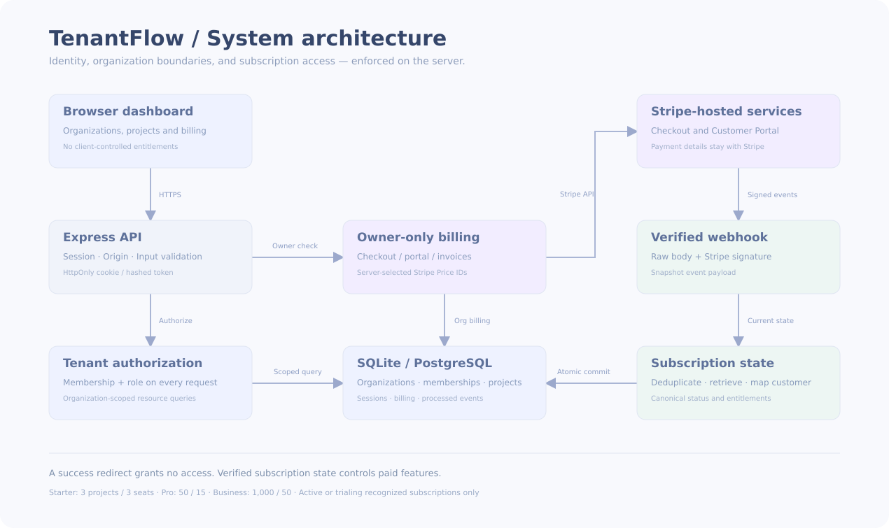

# TenantFlow: a multi-tenant SaaS architecture walkthrough

## 1. Authentication answers who; authorization answers where

A successful sign-in creates an opaque, random server-side session. The browser receives an HttpOnly cookie; the database stores the token hash and expiry. Passwords are salted and derived using scrypt. Password changes revoke all existing sessions and issue a new one to the caller.

Authentication alone does not grant organization access. Every organization route verifies a membership keyed by `(organization_id, user_id)` and checks the action’s allowed role. Resource queries include the authorized organization ID. A guessed project ID from another organization cannot be edited or deleted through the caller’s organization route.

This is application-enforced tenant isolation. PostgreSQL row-level security is a separate defense-in-depth enhancement, not something this repository claims to implement.

## 2. Roles keep permissions explicit

- **Owner:** projects, invitations, role changes, organization settings, audit, and billing.
- **Admin:** projects, member invitations/removal, audit, and paid insights; no billing or owner controls.
- **Member:** view the team and create/edit projects; no deleting projects or administering access.

Invitations are one-use secret tokens stored as hashes, tied to an account email, and valid for 24 hours. Acceptance checks usage limits transactionally. The app does not deliver invitation email or verify account email ownership; copied secret links are the possession factor in this learning implementation. A production rollout should add verified email ownership.

## 3. Database transactions protect plan limits

Each organization owns its projects, memberships, invitations, audit entries, and Stripe identifiers. Local SQLite transactions are serialized. PostgreSQL uses per-organization advisory locks around quota changes and billing updates.

Project creation checks the effective plan and current project count inside the same transaction as insertion. Invitation acceptance repeats the seat check before membership insertion. Two parallel requests cannot independently observe spare quota and both exceed it.

When a subscription becomes non-entitled, effective limits fall back to Starter. Existing data is retained; additions are blocked when over quota. Paid insights are gated on the server.

## 4. Stripe owns payment details

Only the organization owner can create Checkout sessions or open the Customer Portal. The server selects from configured Price IDs; browser input cannot supply a custom amount or grant a plan.

Customer creation uses a stable organization idempotency key. Repeated Checkout requests reuse an existing open session for the same plan, and a recognized non-canceled subscription prevents a second Checkout flow. The portal is the management path for existing subscriptions.

Each organization has a separate server-stored Stripe customer. The app keeps no card number, CVC, or payment-method secret. Invoice links come from Stripe; the UI receives only invoice display data.

## 5. A redirect is not payment proof

Returning from Checkout does not activate entitlements. The webhook endpoint runs an Express raw-body parser before JSON middleware and verifies the Stripe signature with the endpoint signing secret.

For recognized snapshot events, the server resolves the organization from its stored customer ID, locks that organization, and checks whether `event.id` was already processed. It retrieves the current Subscription from Stripe and validates the customer match. This canonical retrieval reduces problems caused by out-of-order event snapshots.

Subscription changes and the processed-event record commit together. If a database/API operation fails, the transaction rolls back and the endpoint returns a failure so the delivery can be retried. Concurrent duplicate deliveries serialize and update only once. An old canceled subscription is prevented from replacing a newer active subscription already recorded for that organization.

`active` and `trialing` subscriptions with a recognized configured Price enable paid features. Other statuses fall back to Starter. Scheduling cancellation keeps access while status remains active.

## 6. Client and server have different responsibilities

The client offers organization switching, project CRUD, team controls, plan cards, invoices, and status messages. Hiding controls improves clarity; backend checks provide the actual authorization boundary.

The UI reads the configured Stripe Prices to display actual currency and monthly amounts. A missing configuration disables billing and explains how to set it up. There is no client-side “payment succeeded” shortcut.

## 7. Verification and boundaries

Nine automated HTTP integration scenarios test cross-tenant resource guessing, roles, invitations, quotas under concurrency, origin validation, session/password revocation, owner-only Checkout/portal, repeated requests, signed webhook replay, canonical-state ordering, failed-delivery retries, and cancellation flags.

The signature check uses the Stripe SDK. External provider methods are replaced with deterministic test doubles, so these tests do not claim a successful real sandbox Checkout. Browser QA, actual Stripe sandbox payment/portal/invoice flows, and PostgreSQL deployment still need verification.

The synchronous webhook handler is suitable for a bounded learning demo. A production architecture should durably enqueue verified events, process them in workers, reconcile periodically, monitor failures, maintain database migrations/backups, apply shared rate limiting, and add email verification/MFA/password reset according to product needs.

## Walkthrough recording outline

1. Show two organizations under one account and their independent project lists.
2. Invite an admin/member, then demonstrate allowed and denied actions.
3. Show owner-only subscription creation.
4. Complete real sandbox Checkout with the local webhook listener running.
5. Show verified subscription activation, increased quota, invoice history, and paid insights.
6. Change/cancel through the Customer Portal and refresh canonical status.
7. Explain the diagram and show the test results.

Review the LinkedIn draft in [LINKEDIN-POST.md](LINKEDIN-POST.md) and add actual demo/repository links after validation.
